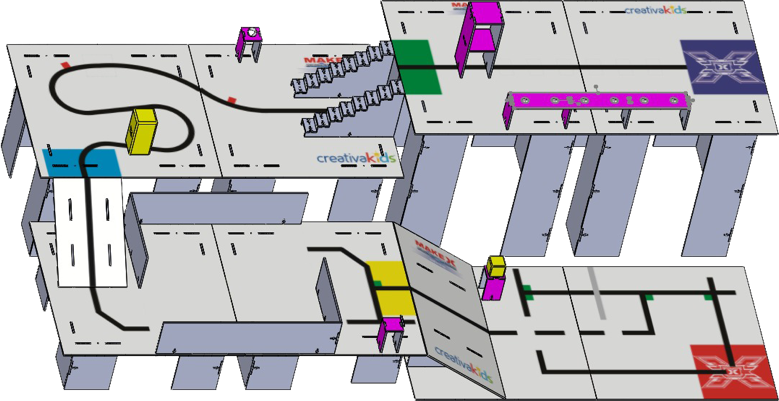

# Estrategia del autónomo (borrador)

La ruta está en [`software/autonomous/missions.py`](../software/autonomous/missions.py) como
listas de pasos. Se armó con las vistas de la arena del reglamento y **no se ha probado en
pista**. Los giros, distancias y conteos se ajustan ahí, sin tocar la lógica.

| Nivel | Inicio | Recorrido previsto | Primitivas |
| --- | --- | --- | --- |
| 1 | X roja | **Por comandos** (experiencia: seguir la línea delgada no funcionaba): "avanza X cm sosteniendo el rumbo Y" con el IMU; cada tramo termina en una línea que cruza el camino (`cross`) para reiniciar el error. Tomar el cubo, ir al pie de la rampa y subirla con control activo | `ref`, `drive`, `cross`, `approach_ped`, garra, `hold` 5 s; en la rampa: seguir la línea (no subir en diagonal), brazo bajo al frente (`h_climb`) y potencia que sube de a poco (`tip_slew`) |
| 2 | Zona amarilla | Tramo hasta el pedestal: dejar el cubo. Pasillo entre muros sin línea, con recortes sueltos: cruzarlo recto con giroscopio. Rampa blanca | `line … junction` + `approach_ped`, `straight` lento, `spin` para recuperar la línea, `climb` |
| 3 | Zona azul | Curva en S con el prisma sobre la línea: empujarlo hasta la marca roja y rodearlo. Pedestal de la pelota a un lado. Escalera | `line … color red` a velocidad de empuje, `detour`, `approach_obj` (pelota), `stairs` |
| 4 | Zona verde | Torre fija sobre la línea: rodearla. Tarjetas de color junto a la barra: leerlas y recordar la roja. Regresar a la casilla roja y dejar la pelota. Seguir hasta la X azul y parar | `leave green` + `to_tower` (distancia desde la zona), `detour`, `cards`, `drop_red`, `stop_in blue` |

## Decisiones

- **Nivel 1 por comandos, no siguiendo la línea** (experiencia previa: con la línea delgada y las
  marcas verdes fallaba). Rectas con rumbo absoluto del IMU que terminan en una línea
  perpendicular; en el simulador, 100 % de 40 corridas con ruido (también con línea de 10 mm).
- **Rampas y escalera con control activo contra volcadura**: brazo bajo y al frente durante la
  pendiente (en el simulador, con el centro de masa a 11 cm y una rampa de 35°, el margen sube de
  1.8 a 3.9 cm), potencia que sube de a poco mientras va inclinado, y seguir la línea o sostener
  el rumbo para no subir en diagonal. El simulador calcula el margen contra volcadura de cada
  corrida (`--ramp-deg` prueba rampas de hasta 40°, `--true com_h=…` un centro de masa distinto).
- **Todo lo que depende del chasis va en `cfg.P`** y se ajusta desde el menú del CyberPi.
- **El nivel de inicio se detecta por el color de la zona** (rojo, amarillo, azul o verde).
  Coincide con la regla de reinicio, y también se puede cambiar con el joystick del CyberPi.
- **Misiones críticas y no críticas**: si falla una de navegación (1, 3, 5, 6, 9, 10), el robot
  se detiene; lo conveniente es pedir reinicio en la zona del nivel. Si falla una de
  manipulación, se sigue con la siguiente.
- **Subir rampas y escalera con el pitch del CyberPi**, no por tiempo: se espera a que el robot
  se incline y luego a que quede plano, y se avanzan unos cm más para quedar "completamente
  dentro".
- **Colores por nombre del sensor** (`get_color_sta`, `color_mode = 0`). Si la luz del
  lugar lo confunde, se cambia a `color_mode = 1` (RGB más cercano) con la tabla RGB calibrada en `COLOR_REF`.
- **Tarjetas**: se registran el color y la distancia del encoder de cada una. La pelota se deja
  regresando a la distancia de la roja.

## Pendiente de hardware (define constantes)

- Medidas del diseño propuesto (orugas largas + brazo de paralelogramo con garra): ver
  [geometria.md](geometria.md). Servos: `s1` garra, `s2` brazo.
- Altura y posición del Quad RGB y de la sonda que lee las tarjetas (`CARD_PROBE`, `card_probe_fwd`).
- El robot **no lleva ultrasónico**: medir en la pista las distancias de referencia de
  [geometria.md](geometria.md#sin-ultrasónico-medidas-de-la-pista).
