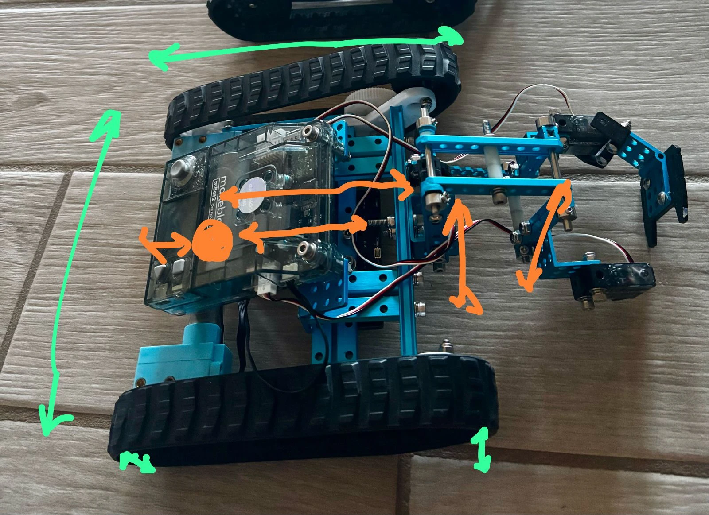

# Hoja de medidas: robot propuesto (orugas largas + brazo de paralelogramo)

Sensores: **solo el Quad RGB** (línea y color), más el giroscopio del CyberPi y los encoders de
los motores del mBot2. Sin ultrasónico. Servos: `s1` garra, `s2` brazo.

Todo en **cm**. Las medidas hacia adelante salen del **punto naranja** (referencia sobre la caja
del mBot2). Los valores se escriben en `P` de [config.py](../software/core/config.py) o desde el
menú del CyberPi.

## Flechas verdes (chasis)

| Flecha en la foto | Clave | Valor |
| --- | --- | --- |
| Larga, horizontal, sobre la oruga de arriba: largo de la oruga, de punta a punta | `track_len` | |
| Larga, vertical, a la izquierda: ancho total, de borde exterior a borde exterior | `robot_w` | |
| Corta, vertical, abajo a la derecha de la oruga: ancho de la banda | `belt_w` | |
| Corta, abajo a la izquierda de la oruga: ⚠️ ¿qué mide? (¿alto de la oruga? ¿diámetro de la rueda?) | `sprocket_d`? | |

## Flechas naranjas (desde la referencia)

| Flecha en la foto | Clave | Valor |
| --- | --- | --- |
| Corta, hacia atrás desde el punto: ⚠️ ¿hasta dónde? (¿parte trasera de la caja?) | (solo informativo) | |
| Larga, de abajo: punto → sondas del Quad RGB (barra negra bajo el chasis) | `sensor_fwd`, `card_probe_fwd` | |
| Larga, de arriba: punto → eje del servo del brazo | `arm_pivot_fwd` | |
| Vertical en el pivote: ⚠️ ¿altura del eje del servo sobre el piso? | `arm_pivot_h` | |
| Vertical en el extremo del brazo: ⚠️ ¿altura del eje del extremo? ¿o de la garra? | (ver abajo) | |

## Faltan en la foto

| Medida | Clave | Valor |
| --- | --- | --- |
| **Punto naranja → punto medio de las orugas** (a lo largo). Es la más importante: el robot gira alrededor de ese punto, no de la caja | `ref_rot_fwd` | |
| Largo de las barras del brazo, **eje a eje** | `arm_len` | |
| Del eje del extremo del brazo al centro de la garra: horizontal / vertical (con el brazo horizontal) | `arm_grip_dx` / `arm_grip_dz` | |
| Del centro de la garra a su punta | `claw_tip` | |
| Separación entre dos sondas vecinas del Quad RGB | `probe_pitch` | |
| Ángulo del servo con el brazo **horizontal**, y si al subir el ángulo el brazo sube (+1) o baja (−1) | `arm_zero`, `arm_dir` | |
| Ángulos de la garra: abierta / con cubo / con pelota | `claw_open`, `claw_cube`, `claw_ball` | |

## Cómo comprobar `ref_rot_fwd` en la pista

Poner una cinta en el piso bajo el punto naranja y, desde el menú, usar *Probar giro 90* varias
veces. El punto que **no se mueve** al girar es el centro de giro; su distancia al punto naranja
es `ref_rot_fwd` (positiva si está adelante). Con orugas, el centro real puede correrse hacia
donde está el peso: el valor medido así es el bueno.
